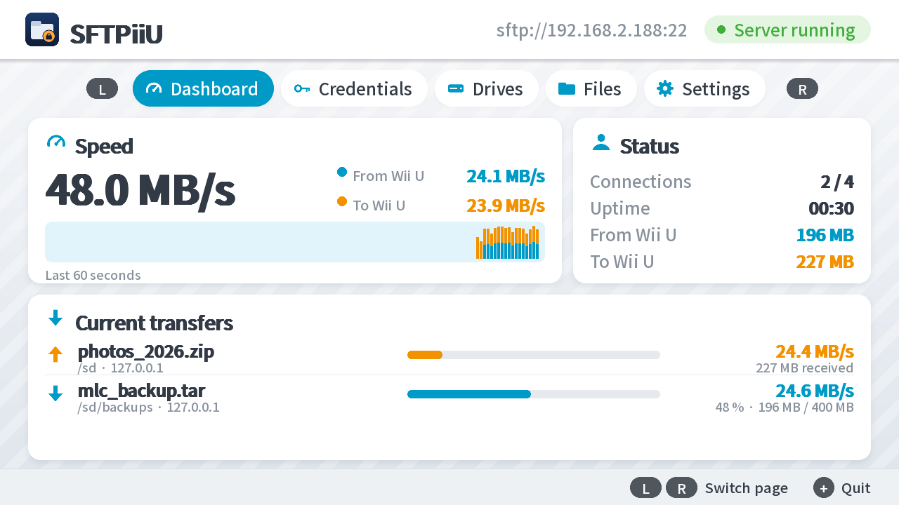
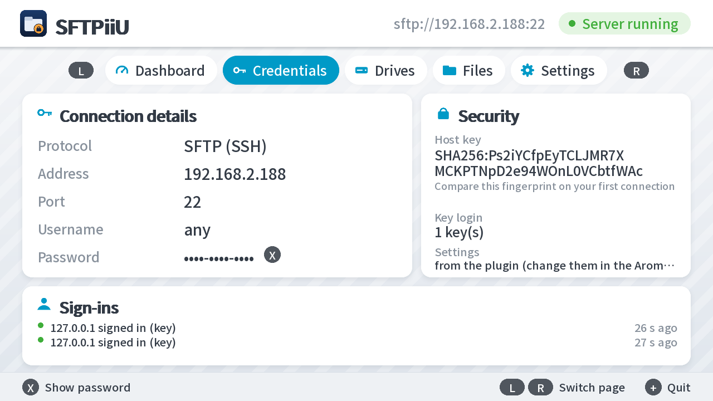
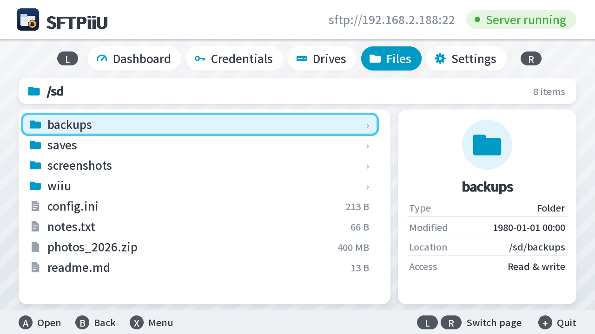
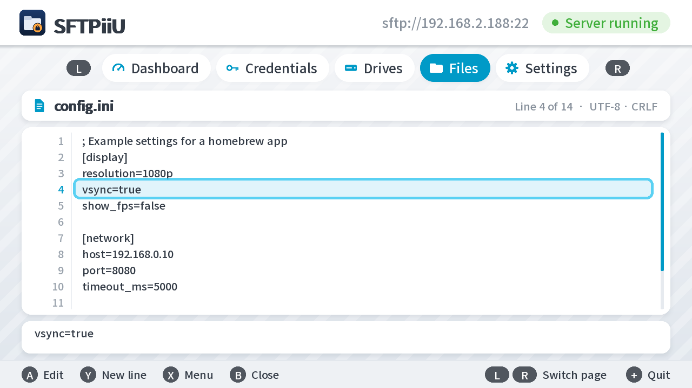
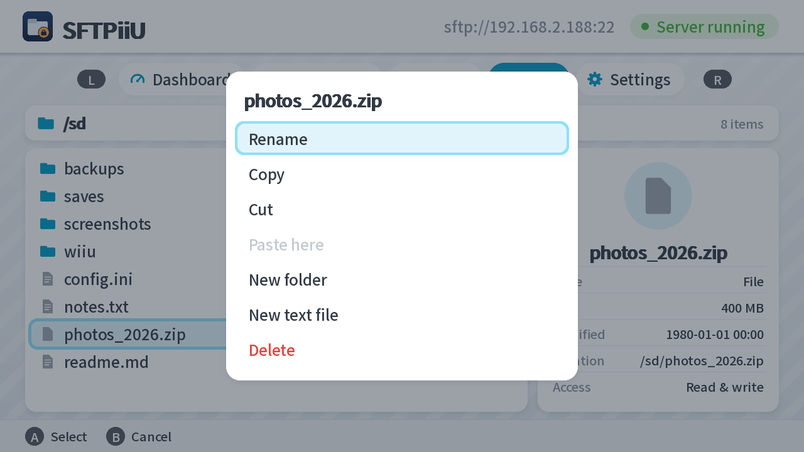
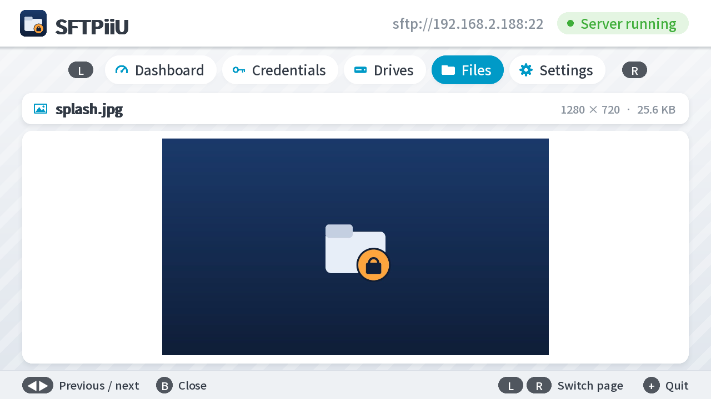
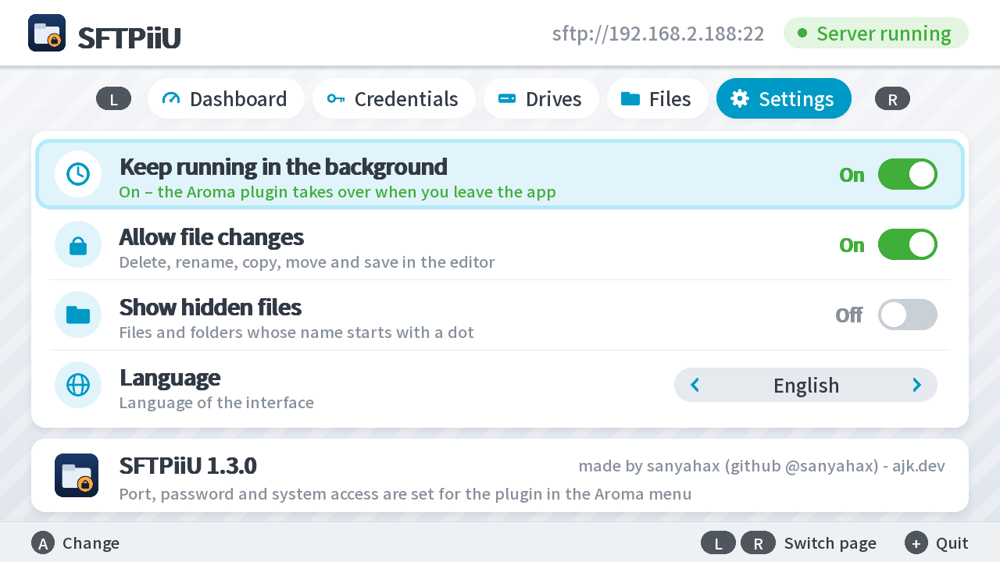

# SFTPiiU

An **SFTP server (SSH)** for the Wii U, as an Aroma plugin and as an app with a live view.
It gives you encrypted, password- or key-protected access to the SD card, MLC, USB and SLC
with any regular SFTP client such as WinSCP, FileZilla, Cyberduck or OpenSSH `sftp`/`scp`.

- **Plugin (`SFTPiiU.wps`)** runs invisibly in the background while you play.
- **App (`SFTPiiU.wuhb`)** shows on the TV and GamePad who is connected and what is being
  transferred: progress, speed, a throughput graph, history and events. It also has a file
  manager, a text editor and an image and hex viewer right on the console.

The plugin and the app can be installed together, see [The app](#the-app).

## Screenshots

<table>
  <tr>
    <td colspan="2"><br>
      <b>Dashboard:</b> total speed, the last 60 seconds, connections and every running transfer</td>
  </tr>
  <tr>
    <td width="50%"><br>
      <b>Credentials:</b> address, password, host key fingerprint and recent sign-ins</td>
    <td width="50%"><br>
      <b>Files:</b> browse the same folders your SFTP client sees</td>
  </tr>
  <tr>
    <td><br>
      <b>Text editor:</b> edit config files line by line with the on-screen keyboard</td>
    <td><br>
      <b>File actions:</b> rename, copy, cut, paste, new folder or file, delete</td>
  </tr>
  <tr>
    <td><br>
      <b>Image viewer:</b> PNG, JPG, BMP, GIF, TGA and WEBP</td>
    <td><br>
      <b>Settings:</b> keep the server running in the background, file changes, language</td>
  </tr>
</table>

The screenshots were taken in Cemu, which only provides the SD card and no file dates.

## Installation

**Easiest:** download the latest `SFTPiiU-v….zip` from
[Releases](https://github.com/sanyahax/SFTPiiU/releases), copy its `wiiu` folder to the root of
your SD card (merge it with the existing one) and restart the console. The zip contains both the
app and the plugin, already in the right folders.

Or by hand:

1. Copy `SFTPiiU.wps` to `SD:/wiiu/environments/aroma/plugins/`.
   (Or let the app install it for you, see [Keep running in the background](#keep-running-in-the-background).)
2. Restart the Wii U. The server starts automatically with every application, including the
   Wii U Menu.
3. Open the Aroma menu with **L + D-pad down + Minus** and select **SFTPiiU**. It shows:
   - the address, e.g. `sftp://192.168.0.23:22`,
   - the **password** (generated randomly on first start; press **A** on it for a new one),
   - the **host key fingerprint** `SHA256:…`.

The plugin's Aroma menu is currently in German. Its entries:

| Entry | Meaning |
|---|---|
| SFTP-Server: an / aus | server on / off |
| Zugriff auf MLC / SLC / USB: ja / nein | access to internal storage, USB and SLC |
| SLC beschreibbar: ja / nein | allow writing to the SLC (see the warning below) |
| Passwort-Login: erlaubt / aus | password login allowed / off |
| Port | 22, 2222 or 8022 |
| Passwort | the password; **A** generates a new one |

## The app

1. Copy `SFTPiiU.wuhb` to `SD:/wiiu/apps/`. It then shows up in the Wii U Menu.
2. Start the app. The server runs as long as the app is open.

The interface, styled after the Wii U Menu, has five pages. Switch between them with **L/R**
or by tapping the tabs on the GamePad:

| Page | Contents |
|---|---|
| **Dashboard** | Total speed, split into from/to the Wii U, a graph of the last 60 s, status (connections, uptime, totals) and the running transfers with progress and speed, followed by the recently finished ones |
| **Credentials** | Address, port, user name, password (**X** shows it, **Y** twice generates a new one), host key fingerprint, key login and the recent sign-ins including failed attempts |
| **Drives** | SD, MLC, USB, SLC, vWii and disc with access rights and free space; **A** opens the drive in the file browser |
| **Files** | File browser over the same folder structure as via SFTP, with details for the selection. **A** opens folders and files, **B** goes back, **X** opens the file actions, **ZL/ZR** or left/right scroll by page |
| **Settings** | Keep running in the background, allow file changes, show hidden files, language |

**+** quits the app. For SD cards the Wii U shows no free space, because finding it out on
FAT32 would be very slow.

### Keep running in the background

A Wii U app ends as soon as you leave it. To keep the server running anyway, in the Wii U
Menu and while you play, there is a switch under **Settings → Keep running in the background**:

- **On:** If the plugin is not installed yet, the app asks and then copies its bundled
  `SFTPiiU.wps` into Aroma's plugin folder (`SD:/wiiu/environments/aroma/plugins/`). The plugin
  gets the same password and host key as the app, so your client won't notice a difference.
  After a **console restart** the server keeps running permanently. An older installed plugin
  version is replaced.
- **Off:** The plugin stays installed but no longer starts the server. This applies from the
  next application you start; no restart needed (plugin 1.3.0 and later; older plugin versions
  only read the setting on restart).

The line below the switch tells you what currently applies: **"On – the Aroma plugin takes over
when you leave the app"** (green) or **"Takes effect after restarting the console"** (orange).
The switch is the same setting as **SFTP-Server** in the plugin's Aroma menu; both always show
the same state.

### Viewing and editing files

**A** on a file opens the matching viewer:

| File type | View |
|---|---|
| Text (`txt`, `ini`, `cfg`, `json`, `xml`, `log`, `md`, `csv`, `yml`, `toml`, `lua`, `js`, `py`, `sh`, `c`/`h`/`cpp`, `html`, `css` and anything without NUL bytes) up to 1 MB | **Text editor** with line numbers. **A** edits the line with the on-screen keyboard, **Y** inserts a new line below, **X** opens a menu with duplicate, delete, undo and save. Line endings (LF/CRLF), the UTF-8 BOM and the final newline are kept. Saving writes to a temporary file first, so an error never destroys the old file. Closing with unsaved changes asks first |
| Images (`png`, `jpg`, `bmp`, `gif`, `tga`, `webp`) up to 16 MB and 4096 × 4096 pixels | **Image viewer**; left/right go to the previous or next image in the folder |
| anything else | **Hex view** of the first 64 KB |

### Changing files

Out of the box the file browser is read-only. **Settings → Allow file changes** unlocks, after
a confirmation:

- **X** in the file browser: rename, copy, cut, paste here, new folder, new text file and
  delete (with confirmation),
- saving in the text editor.

Copying, moving and deleting run in the background with a progress dialog and can be canceled
with **B**. A canceled copy removes its partial result; when moving, the source is only
deleted once the copy is complete. If the name already exists at the destination, the copy is
called e.g. `file (2).txt`. Drives that may only be read (see [Folders](#folders), e.g. the
SLC) stay protected even with this setting.

**Languages:** The app follows the console's system language and supports all twelve Wii U
languages: Japanese, English, French, German, Italian, Spanish, Chinese (simplified and
traditional), Korean, Dutch, Portuguese and Russian, using the console's matching system font.
Numbers use the local decimal separator. **Settings → Language** can also pin a different
language.

**Working together with the plugin:** Aroma loads plugins into homebrew apps too, so the plugin
already holds the port when the app starts. The app therefore asks the plugin over a local
connection to step aside. The plugin only accepts this from the console itself and pauses until
the app exits. The app also takes **password, host key, port and options from the plugin's
configuration**, so your client doesn't raise a "host key changed" alarm. You keep changing
those settings in the Aroma menu.

The app stores its settings in `SD:/wiiu/sftpiiu/app.cfg`. `fileActions`, `showHidden` and
`language` (`auto` or 0–11) always apply. Port, password, `systemAccess`, `slcWritable` and
`passwordLogin` are only used while the plugin is not set up.

## Connecting

| Field | Value |
|---|---|
| Protocol | SFTP |
| Host | the console's IP address (shown in the menu) |
| Port | 22 (2222 or 8022 can be chosen in the menu) |
| User | anything, e.g. `wiiu` |
| Password | shown in the menu |

On the first connection your client asks whether to trust the host key. Compare the
fingerprint it shows with the one in the menu; only then do you know for sure that you are
talking to your console. The key stays the same permanently.

```bash
sftp wiiu@192.168.0.23
```

### Key login (recommended)

1. Create a key on your PC: `ssh-keygen -t ed25519`
2. Add the contents of `~/.ssh/id_ed25519.pub` as a line of its own to
   `SD:/wiiu/sftpiiu/authorized_keys`. The plugin creates the folder itself.
   The file is read again on every login, no restart needed.
3. Once the key works, you can set **Passwort-Login: aus** (password login off) in the menu.

Only `ssh-ed25519` keys are supported; RSA keys are rejected.

## Folders

| Path | Contents | Default |
|---|---|---|
| `/sd` | SD card | read and write |
| `/storage_mlc` | internal storage (games, updates, saves, system) | read and write |
| `/storage_usb` | USB drive (only when connected) | read and write |
| `/storage_slc` | system NAND (SLC) | **read only** |
| `/slccmpt01` | vWii NAND | **read only** |
| `/storage_odd_*` | inserted disc | read only |

MLC, USB and SLC need the MochaPayload, which Aroma includes by default. With
**Zugriff auf MLC / SLC / USB: nein** (no system access) only the SD card is visible.

> **Warning:** With **SLC beschreibbar: ja** (SLC writable) you can change or delete system
> files. A mistake there can permanently brick the console. Leave it off unless you really
> need it, and make a NAND backup first.

## Security

- **Encryption:** key exchange `curve25519-sha256`, host key `ssh-ed25519`, ciphers
  `chacha20-poly1305@openssh.com` and `aes128/192/256-ctr` with `hmac-sha2-256`, plus strict
  KEX against the Terrapin attack. Older, insecure algorithms (SHA-1, CBC, DSA) are not built
  in at all.
- **Password:** 12 random characters (about 59 bits), compared in constant time. After every
  failed attempt the server waits 1.5 seconds; after 5 failures it disconnects. After 10
  failures within 10 minutes, password login is locked for everyone for 5 minutes. Every login
  and every failed attempt shows up as a notification on screen.
- **Timeouts:** 60 seconds to log in; connections are closed after 30 minutes of inactivity.
- **Randomness:** The Wii U offers plugins no random source. The generator is seeded at start
  from a stored seed, the console's OTP and SEEPROM (console-specific secrets, only hashed and
  never stored or sent) and timer jitter.
- **Self-test:** At start the plugin checks all crypto building blocks against official test
  vectors. If that fails, the server stays off and the menu shows the error.
- Password, host key and settings are stored in
  `SD:/wiiu/environments/aroma/plugins/config/sftpiiu.json`. Whoever has your SD card also has
  the password.

The plugin is meant for your home network. Do **not** forward the console's port 22 in your
router.

## Limitations

- Switching applications (starting or quitting a game) drops open connections, just like with
  ftpiiu. Most clients simply reconnect.
- At most 4 simultaneous connections, SFTP only (no shell, no port forwarding).
- No symlinks; file permissions and timestamps cannot be set on the Wii U. Clients still get
  "OK" for those so that uploads don't abort.

## Building

Requires [devkitPro](https://devkitpro.org/wiki/Getting_Started) with `wiiu-dev`, plus
[WiiUPluginSystem](https://github.com/wiiu-env/WiiUPluginSystem),
[libmocha](https://github.com/wiiu-env/libmocha) and
[libnotifications](https://github.com/wiiu-env/libnotifications), each via `make install`.
The app additionally needs `pacman -S wiiu-sdl2 wiiu-sdl2_ttf wiiu-sdl2_image`.

Plugin:

```bash
make
```

App (builds the plugin as well and embeds it for "Keep running in the background"):

```bash
make -C app
```

On Windows with Smart App Control enabled, Windows blocks GCC's LTO plugin DLL. In that case
add `EXTRA_LDFLAGS=-fno-use-linker-plugin`:

```bash
make EXTRA_LDFLAGS=-fno-use-linker-plugin
```

`python app/tools/make_art.py app` regenerates the app's icon and splash images.

The app also runs in **Cemu** (`Cemu.exe -g SFTPiiU.wuhb`), but only with the SD card, because
there is no MochaPayload. Cemu forwards the port to the PC. Note: Cemu 2.6 crashes when a file
or folder name with non-ASCII characters (such as umlauts) is on its emulated SD card
(`%APPDATA%\Cemu\sdcard`) and a directory is read. This only affects the emulator.

For UI tests there is a remote-controlled variant:
`make -C app UI_TOUR=1 TARGET=SFTPiiU_tour BUILD=build_tour`. It reads commands such as
`tab 2`, `lang 0`, `open /sd`, `select 3`, `pw`, `press X` (buttons A, B, X, Y, L, R, ZL, ZR,
up, down, left, right) or `text name.txt` (confirms the on-screen keyboard with that text)
from `SD:/sftpiiu_tour.txt`.

Alternatively with Docker, like the wiiu-env projects:

```bash
docker build . -t sftpiiu-builder
docker run --rm -v ${PWD}:/project sftpiiu-builder make
```

Every push to GitHub also builds the `.wps` and `.wuhb` automatically, see
`.github/workflows/build.yml`.

### Testing on a PC

`host/` contains a test setup that runs the same SSH/SFTP code on a PC, with local folders
instead of the Wii U drives:

- `host/build_host.bat` builds a native Windows `.exe` (with `pip install ziglang`).
- `host/wasm/build_wasm.bat` builds the same as WebAssembly, and
  `python host/wasm/run_wasm.py --workdir <folder> -- --port 2222 --root /testroot --password test`
  runs it with `pip install wasmtime`. This also works when Smart App Control blocks
  self-built programs. `<folder>/testroot` needs the subfolders `sd`, `mlc` and `slc`.

## Code layout

| File | Purpose |
|---|---|
| `source/crypto/` | SHA-256/512, HMAC, X25519, Ed25519, ChaCha20-Poly1305, AES-CTR, random generator |
| `source/ssh/session.cpp` | SSH transport, key exchange, authentication, channel |
| `source/sftp.cpp` | SFTP version 3 with `posix-rename`, `fsync`, `statvfs` and `limits` |
| `source/vfs.cpp` | virtual root folder and the drives below it |
| `source/server.cpp` | accepting connections, threads, lockout against password guessing |
| `source/monitor.cpp` | live status for the app: connections, transfers, history, events |
| `source/wiiu/` | shared Wii U part: sockets, Mocha mounts, random generator |
| `plugin/main.cpp` | plugin hooks and config menu |
| `app/source/main.cpp`, `config.cpp` | app: startup, taking over the plugin's settings |
| `app/source/ui.cpp`, `render.cpp` | pages, input and drawing (rounded cards, shadows, icons) |
| `app/source/i18n.cpp`, `format.cpp` | texts in all twelve Wii U languages, number and time formats |
| `app/source/explorer.cpp`, `ui_files.cpp` | file browser, file actions, editor and viewers |
| `app/source/fileops.cpp` | copying, moving and deleting in the background, name checks |
| `app/source/textdoc.cpp` | text document with undo, file type detection, hex data |
| `app/source/ui_settings.cpp` | settings page |
| `app/source/background.cpp`, `pluginjson.cpp` | installing the plugin and switching it on and off through its config file |

## License

MIT, see `LICENSE`. X25519/Ed25519 are based on TweetNaCl (public domain).

---

made by sanyahax ([github @sanyahax](https://github.com/sanyahax)) - ajk.dev
